

# Shamekh Al-Suwi

**AI & FPGA engineer · MSc Artificial Intelligence @ JKU Linz**

Systems, hardware and machine learning, built close to the metal.

## 👋 About

I'm a multidisciplinary AI and software engineer based in **Linz, Austria**, with a background in mechatronics, control systems, computer vision and applied research. I like building systems close to the metal: FPGA computing, custom CPUs, C++ simulation, and hardware-software co-design.

**Open to:** AI research, FPGA / embedded and software engineering roles in Austria and the EU.

**Interests:** efficient ML accelerators, FPGA-based AI, computer architecture, digital arithmetic, and LLM-assisted RTL design and verification.
## 🧭 Skills

| Area | Tools |
|---|---|
| **Hardware** | SystemVerilog, Gowin FPGAs, custom CPUs, USB CDC, Icarus Verilog, Verilator, GTKWave |
| **AI / ML** | PyTorch, deep learning, reinforcement learning, probabilistic models, computer vision, OpenCV |
| **HPC / scientific** | C++17, CUDA, Eigen, numerical simulation, CFD, parallel computing |
| **Software** | C/C++, Python, MATLAB, Dart/Flutter, CMake, Qt, Raylib, Linux, Bash, Git |
| **Systems & control** | Control theory, Simulink, embedded systems, PLCs, signal processing |

## 💼 Experience

- **Freelance Software Developer** *(March 2026 - present)*: C++ applications, Python tools, computer vision, LLM-assisted workflows, simulation, verification, and FPGA exploration
- **Junior Research Engineer**, [Austrian Institute of Technology (AIT)](https://www.ait.ac.at/en/), Technology Experience Department *(October 2024 - March 2026)*: AI system integration, data-driven monitoring systems, real-time AI interfaces, reliability and evaluation, and research-to-application transfer
- **Teaching Assistant**, [JKU Institute of Computer Graphics](https://www.jku.at/institut-fuer-computergrafik/) *(October 2023 - February 2024)*: practical support in computer vision, machine learning, deep learning, data analysis, and system modelling
- **Software Developer Intern**, [Sequality](https://www.sequality.at/en/your-partner-for-technical-software/) *(October 2023 - November 2023)*: industrial software interfaces with C++ and Qt
- **Research Assistant**, [JKU Institute of Semiconductor and Solid State Physics](https://www.jku.at/en/institute-of-semiconductor-and-solid-state-physics/) *(August 2022 - February 2023)*: scientific software for entangled-photon quantum key distribution and secure distributed systems
- **Software Engineer**, [Simma Software](https://www.simma.io/) *(November 2021 - April 2022)*: Selenium automation, integration workflows, and automated testing tools
- **R&D Software Engineer**, [Mixed Dimensions](https://integralrealitylabs.com/) *(February 2020 - November 2021)*: geometry-processing algorithms, computational models, performance optimisation, and repair of damaged 3D models for commercial printing
- **Mechatronics Intern**, Bahbish *(January 2019 - April 2019)*: microscope automation and computer-aided design

## 🎓 Education

- **MSc Artificial Intelligence**, [Johannes Kepler University Linz](https://www.jku.at/en/), Austria *(March 2024 - present)*
  - Machine learning, deep learning, recurrent networks, reinforcement learning, computer vision, probabilistic models, parallel computing, signal processing, adaptive systems, and quantum information
- **BSc Mechatronics Engineering**, [University of Jordan](https://www.ju.edu.jo/), Jordan *(July 2014 - June 2019)*
  - Control theory, robotics, automation, embedded systems, digital logic, electronics, PLCs, sensors, actuators, industrial process control, and CAD
  - **Bachelor's thesis:** Intelligent transportation using vehicle-to-vehicle communication for cooperative vehicle tracking and collision warnings

📄 Full details in my [Europass CV](./Europass_CV/).

## 🏆 Competitive Programming

I competed in national, regional, and international programming contests using **C++**, with a focus on algorithms, data structures, and problem solving.

| Competition | Result |
|---|---:|
| IEEEXtreme 2019 | 93rd of ~9,400 participants |
| Africa & Arab Collegiate Programming Contest 2019 | 28th place |
| Jordan Collegiate Programming Contest 2019 | 5th place |
| Jordan Collegiate Programming Contest 2018 | 13th place |
| Arab Collegiate Programming Contest 2017 | 92nd place |

[Certificates](./Certificates/)

## 🚀 Projects

**Index:** [cfd-sim](#cfd-sim) · [cv_deepSort](#cv_deepsort) · [OpenJoey2](#openjoey2) · [doomai](#doomai) · [fpga-snn](#fpga-snn) · [Ahoy](#ahoy) · [Kalman GPS Tracking](#kalman-gps-tracking) · [Mean-Shift Clustering](#mean-shift-clustering) · [cooda](#cooda) · [fpga-usb](#fpga-usb) · [fpga-skill](#fpga-skill) · [pysuwi](#pysuwi)

### [cfd-sim](https://github.com/shamekhing/cfd-sim)

A computational fluid dynamics engine written from scratch. It simulates air flowing around a cylinder by solving the incompressible Navier-Stokes equations on a staggered grid with the SIMPLE algorithm, and it reproduces the Kármán vortex street shown in the capture. Optional CUDA acceleration.

`C++17` `CUDA` `Numerical Methods`

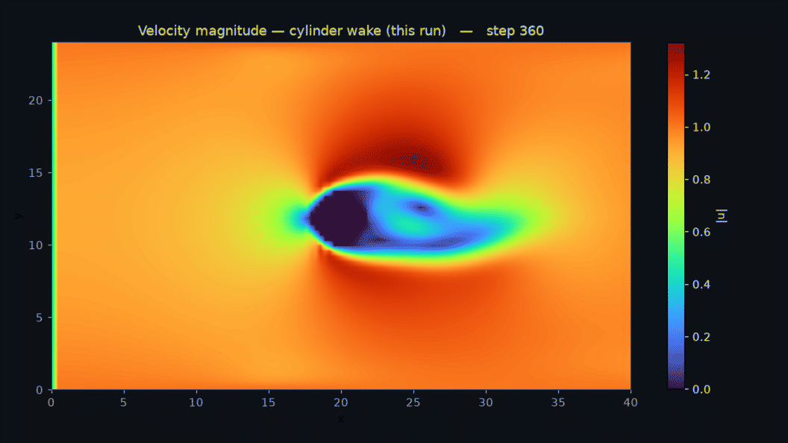

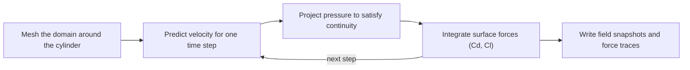

### [cv_deepSort](https://github.com/shamekhing/cv_deepSort)

A multi-object tracking pipeline for video. YOLOv5 detects objects in each frame and Deep SORT keeps a stable identity on each one by combining motion prediction with appearance embeddings. Built for drone footage, with recorded result clips.

`Python` `PyTorch` `OpenCV`

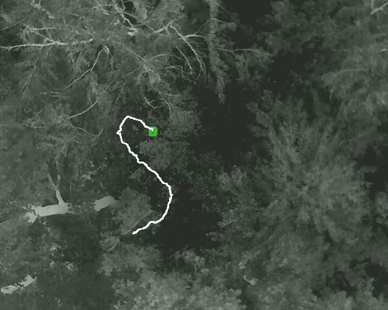

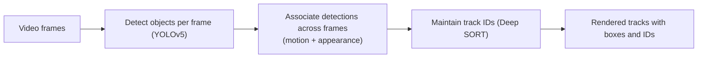

### [OpenJoey2](https://github.com/shamekhing/OpenJoey2)

A Yu-Gi-Oh! engine that implements the classic ruleset from scratch in C++17: summon types, attack and defense math, chains with Spell Speeds, and bounded undo snapshots. A raylib interface drives the game, and the same code builds for the browser.

`C++17` `Raylib` `Game Engine`

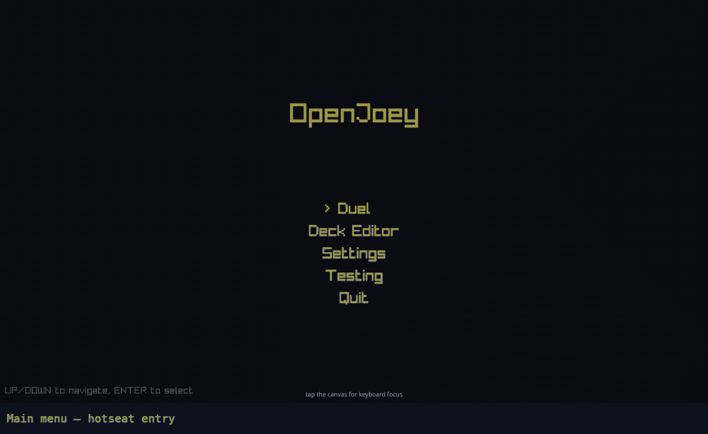

<table align="center">
  <tr>
    <td>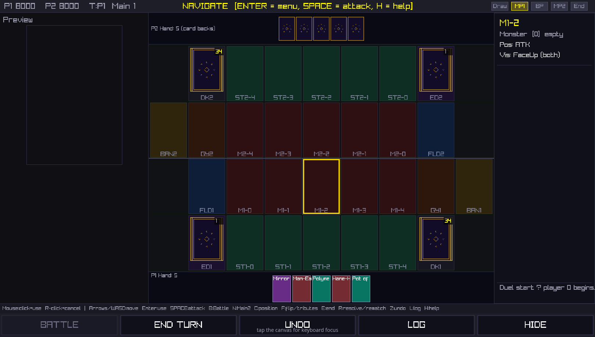</td>
    <td>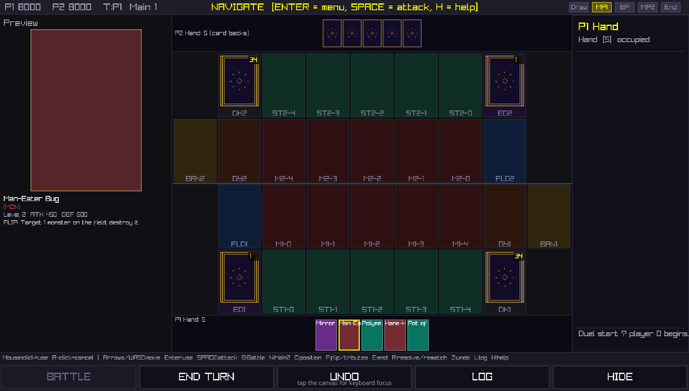</td>
    <td>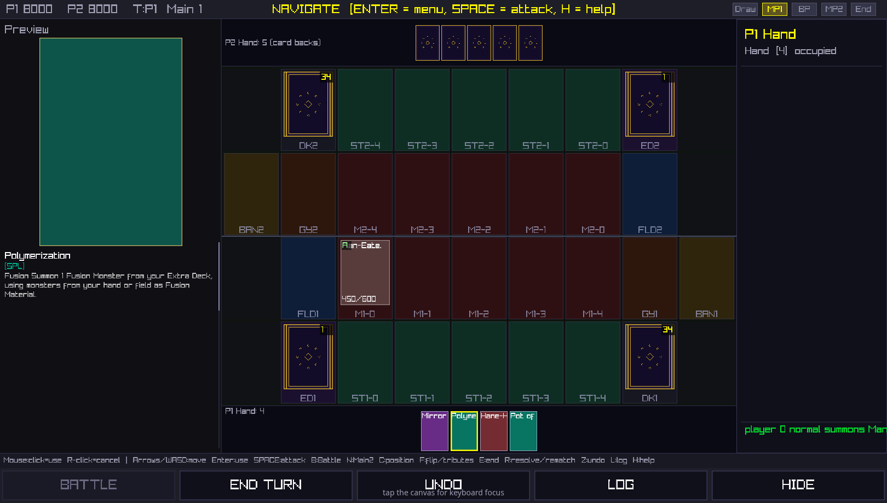</td>
  </tr>
  <tr>
    <td>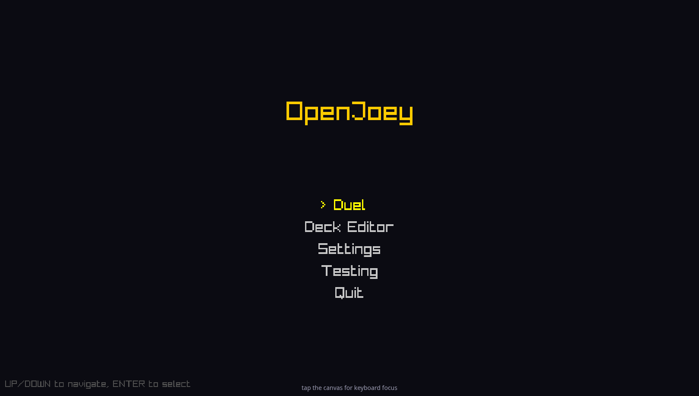</td>
    <td>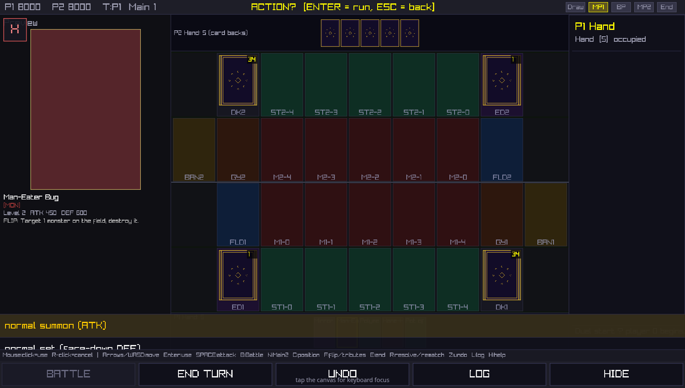</td>
    <td>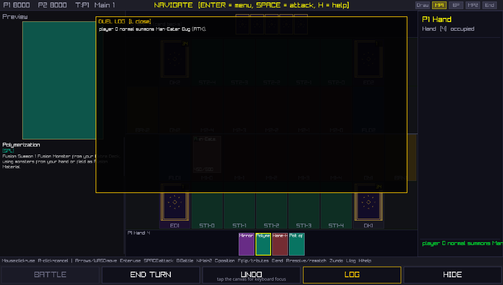</td>
  </tr>
</table>

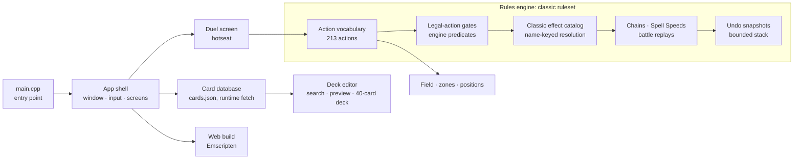
### [doomai](https://github.com/shamekhing/doomai)

Reinforcement learning agents for the JKU ViZDoom deathmatch challenge. Each agent first learns by imitating recorded human play, then improves with PPO and DQN training rewarded for frags, and exports to ONNX.

`Python` `PyTorch` `RL`

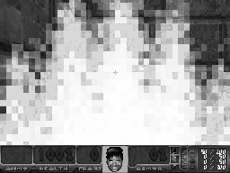

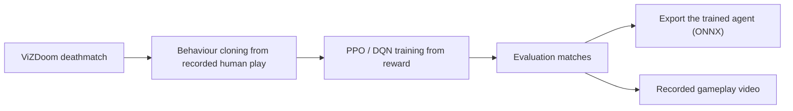

### [fpga-snn](https://github.com/shamekhing/fpga-snn)

An experimental spiking neural network accelerator for MNIST, where neurons carry information as spike timing instead of numbers. A Python trainer learns the weights and a SystemVerilog datapath replays them on a Gowin FPGA.

`SystemVerilog` `Python` `SNN`

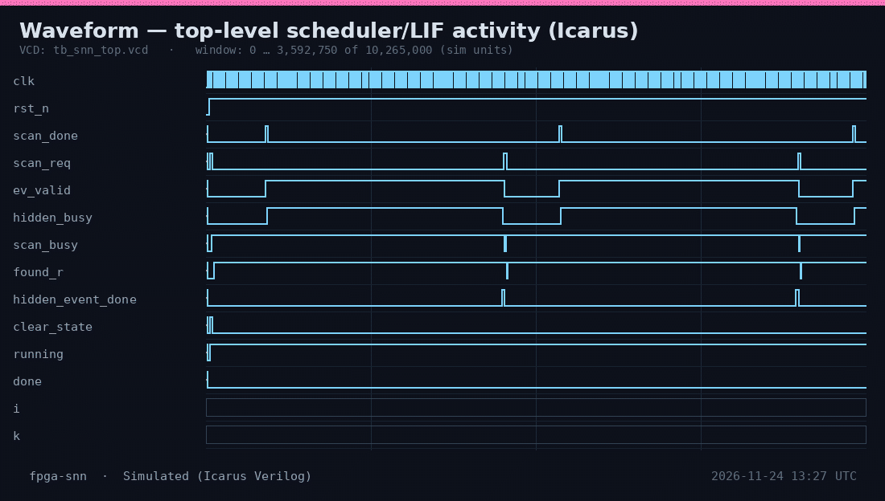

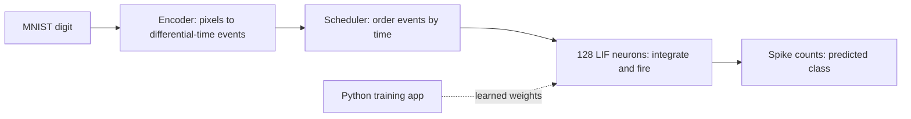

### [Ahoy](https://github.com/shamekhing/Ahoy)

A privacy-first messaging app in Flutter for phones that are near each other. It picks the best direct link (Wi-Fi Direct, LAN or Bluetooth), encrypts messages end to end so keys never leave the phone, and needs no server or account.

`Dart` `Flutter` `Privacy`

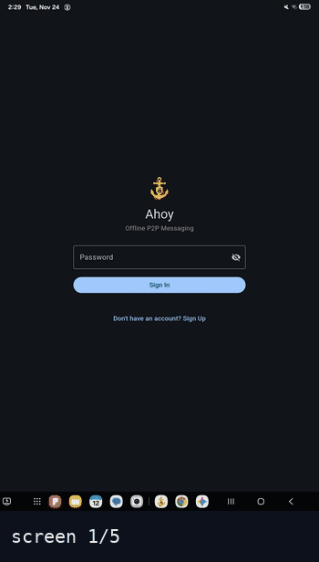

### [Kalman GPS Tracking](https://github.com/shamekhing/Kalman-Filter-for-GPS-Tracking)

A header-only C++ Kalman filter that turns jumpy GPS fixes into a smooth route. It predicts where the vehicle should be, blends that with each GPS measurement, and outputs a cleaned position and velocity track.

`C++` `Eigen` `State estimation`

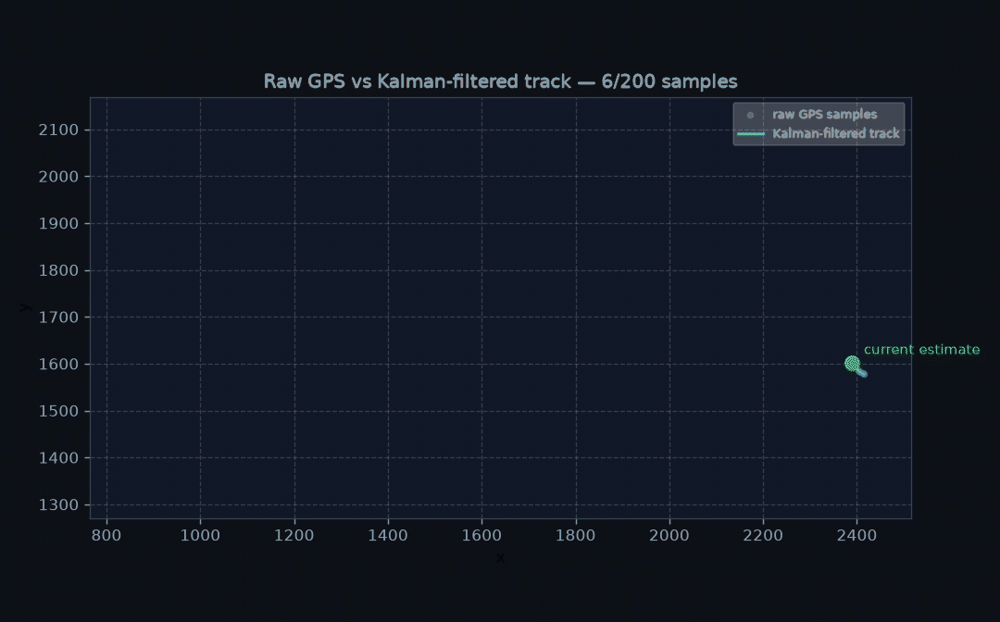

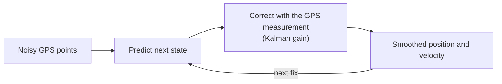

### [Mean-Shift Clustering](https://github.com/shamekhing/Mean-Shift-Clustering)

A mean-shift clustering implementation in C++ and Eigen. It groups 2-D points without being told how many clusters exist, shifting each point toward its neighborhood mean until they settle together.

`C++` `Eigen` `Clustering`

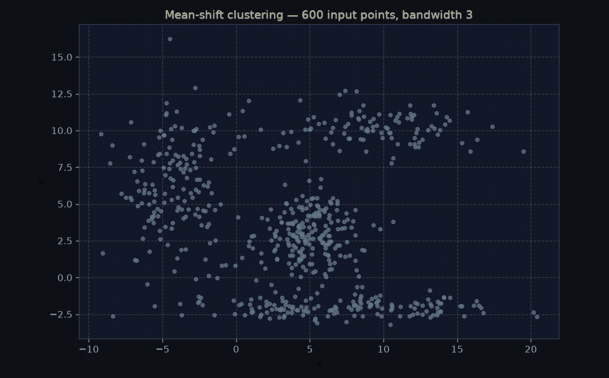

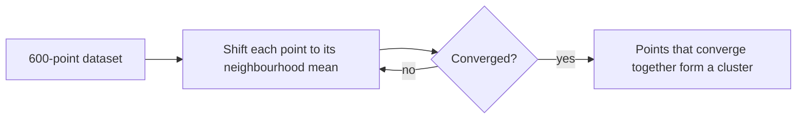

### [cooda](https://github.com/shamekhing/cooda)

A complete 32-bit computer built from scratch in SystemVerilog: a 26-bit instruction set, a 64 × 32-bit register file, a bit-serial ALU, and a bus connecting BSRAM, DDR3 and an HDMI display. There is no vendor CPU core, and it boots a handwritten-digit demo over HDMI.

`SystemVerilog` `Computer Architecture` `FPGA`

_Specification from the RTL: 32-bit word, 26-bit instruction set, 64 × 32-bit register file, multi-cycle bit-serial ALU, 32 KiB BSRAM, 128 MiB DDR3, 27 MHz core clock, HDMI 720p60 output._

Datapath:

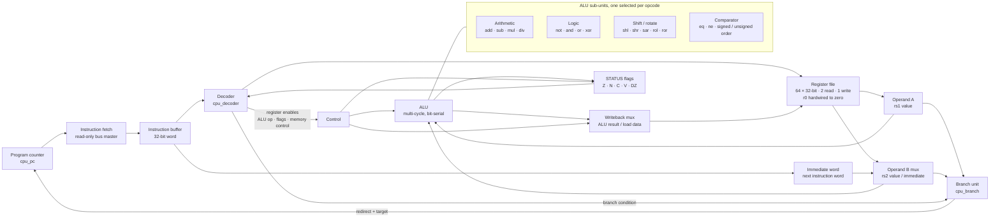

Control sequence:

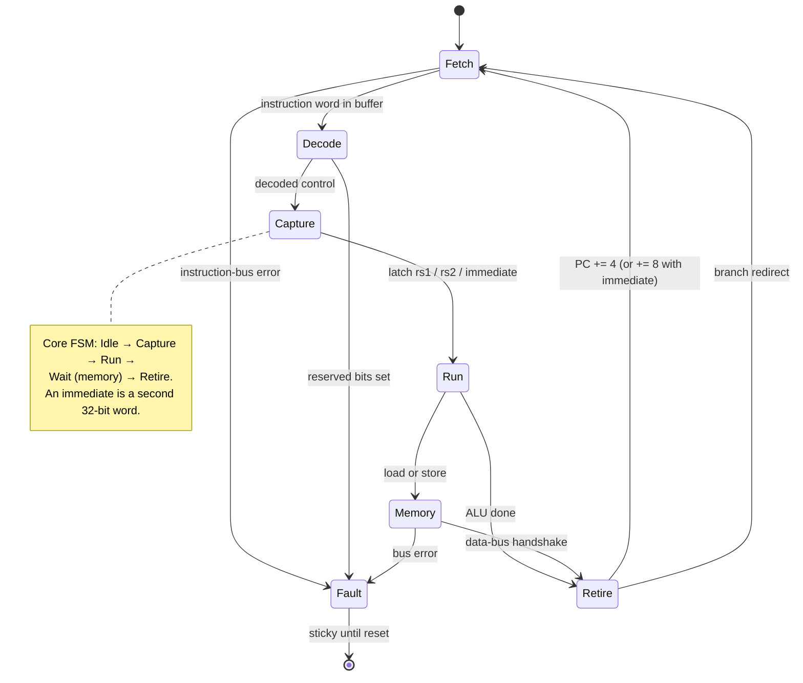
System bus and memory:

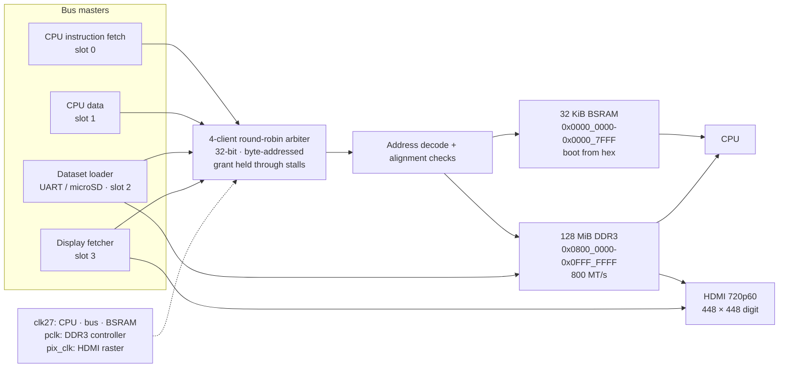

Chip overview:

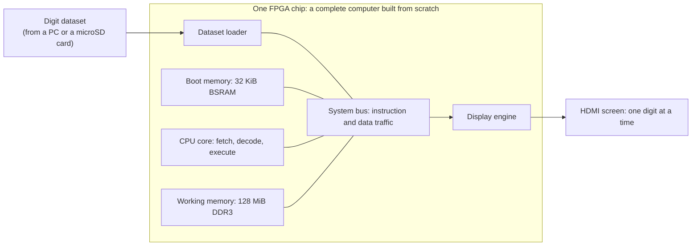

### [fpga-usb](https://github.com/shamekhing/fpga-usb)

A USB CDC serial device implemented on a Gowin FPGA through an external ULPI PHY. It turns the FPGA into a USB device a computer can talk to, with SystemVerilog testbenches and host-side tools.

`SystemVerilog` `USB` `FPGA`
### [fpga-skill](https://github.com/shamekhing/fpga-skill)

A reusable engineering workflow for Gowin FPGA projects, distilled from many working sessions: one guide per task (RTL, simulation, synthesis, timing, programming, debugging) plus tested scripts and checklists that stop steps being skipped.

`SystemVerilog` `Gowin` `Tooling`

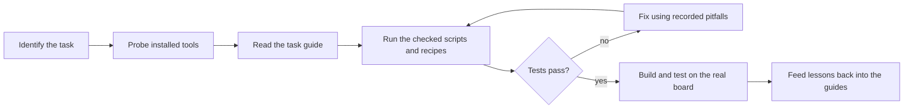

### [pysuwi](https://github.com/shamekhing/pysuwi)

A command-line toolbox with one rule: drop a Python file in the plugins folder and it becomes a subcommand, with no registration needed. It ships with a pinned installer and a doctor command that reports installation health.

`Python` `CLI` `Tooling`

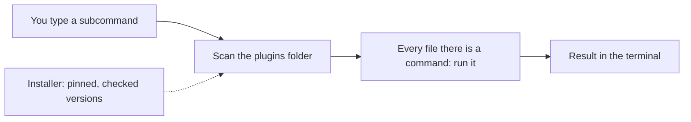

   
  <em>Building at the intersection of code, hardware and intelligent systems.</em>

