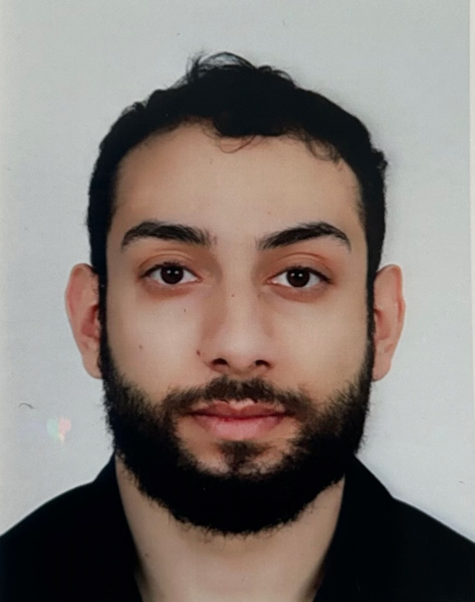

  
  

    <strong>Lawful evil programmer &amp; Agentic AI offender 😅</strong>
  

  
  
  

  

  

## 👋 About Me

I am **Shamekh Al-Suwi**, a programmer based in **Linz, Austria**, associated with **Johannes Kepler University (JKU)**.

I enjoy building things close to the metal and exploring the boundary between software, hardware, and intelligent systems. My public work ranges from machine learning and language models to FPGA projects, C++ runtimes, virtual machines, and games.

I am currently pursuing an **MSc in Artificial Intelligence at Johannes Kepler University Linz**. My background is in **mechatronics engineering**, with experience across applied AI research, industrial software, automation, computer vision, scientific computing, and embedded intelligence.

## 🧭 What I Build

- **AI and machine learning:** PyTorch projects, deep learning experiments, and language models built from scratch
- **FPGA and digital hardware:** SystemVerilog designs, Gowin FPGA workflows, and an experimental spiking neural network
- **High-performance systems:** C++17, CUDA, numerical simulation, interpreters, and virtual machines
- **Robotics and computer vision:** tracking, filtering, simulation, and intelligent systems
- **Creative software:** retro games, game engines, tooling, and personal experiments

## 💼 Experience

- **Freelance Software Developer:** Independent development of C++ applications, Python tools, computer-vision applications, LLM workflows, and FPGA experiments *(March 2026 - present)*
- **Junior Research Engineer:** [Austrian Institute of Technology](https://www.ait.ac.at/en/), Technology Experience Department *(October 2024 - March 2026)*
- **Teaching Assistant:** [JKU Institute of Computer Graphics](https://www.jku.at/institut-fuer-computergrafik/) *(October 2023 - February 2024)*
- **Software Developer Intern:** [Sequality](https://www.sequality.at/en/your-partner-for-technical-software/) *(October 2023 - November 2023)*
- **Research Assistant:** JKU Institute of Semiconductor and Solid State Physics *(August 2022 - February 2023)*
- **Software Engineer:** [Simma Software](https://www.simma.io/) *(November 2021 - April 2022)*
- **R&D Software Engineer:** [Mixed Dimensions](https://integralrealitylabs.com/) *(February 2020 - November 2021)*
- **Mechatronics Intern:** Bahbish, working on microscope automation and CAD *(January 2019 - April 2019)*

## 🎓 Education

- **MSc Artificial Intelligence:** [Johannes Kepler University Linz](https://www.jku.at/en/), Austria *(March 2024 - present)*
  - Machine learning, deep learning, computer vision, reinforcement learning, probabilistic models, parallel computing, signal processing, and quantum information
- **BSc Mechatronics Engineering:** [University of Jordan](https://www.ju.edu.jo/), Jordan *(July 2014 - June 2019)*
  - Control theory, robotics, automation, embedded systems, digital logic, electronics, PLCs, sensors, actuators, and industrial process control

## 🛠️ Technology

  

  
  
  
  

## 🚀 Featured Projects

<table>
  <tr>
    <td width="50%" valign="top">
      <h3><a href="https://github.com/shamekhing/OpenCode">OpenCode</a></h3>
      
A GPT-style transformer language model built from scratch with Python and PyTorch, trained on public GitHub repositories.

      
<code>Python</code> <code>PyTorch</code> <code>Transformers</code>

    </td>
    <td width="50%" valign="top">
      <h3><a href="https://github.com/shamekhing/fpga-snn">fpga-snn</a></h3>
      
An experimental spiking-neural-network project for MNIST combining a Python reference workflow with SystemVerilog for a Gowin FPGA.

      
<code>SystemVerilog</code> <code>Python</code> <code>FPGA</code>

    </td>
  </tr>
  <tr>
    <td width="50%" valign="top">
      <h3><a href="https://github.com/shamekhing/cfd-sim">cfd-sim</a></h3>
      
A modular C++17 computational fluid dynamics solver using the SIMPLE algorithm, staggered grids, CUDA acceleration, and asynchronous I/O.

      
<code>C++</code> <code>CUDA</code> <code>Numerical Methods</code>

    </td>
    <td width="50%" valign="top">
      <h3><a href="https://github.com/shamekhing/OpenJoey2">OpenJoey2</a></h3>
      
An open-source implementation of Yu-Gi-Oh! Power of Chaos games, built from scratch with C++ and raylib.

      
<code>C++</code> <code>Raylib</code> <code>Game Development</code>

    </td>
  </tr>
  <tr>
    <td width="50%" valign="top">
      <h3><a href="https://github.com/shamekhing/Lacooda">Lacooda</a></h3>
      
A retro game console built from scratch on an FPGA.

      
<code>SystemVerilog</code> <code>FPGA</code> <code>Hardware</code>

    </td>
    <td width="50%" valign="top">
      <h3><a href="https://github.com/shamekhing/flash2html5">flash2html5</a></h3>
      
A Python tool for converting Adobe Flash games to modern HTML5 and JavaScript with the help of LLMs.

      
<code>Python</code> <code>JavaScript</code> <code>LLMs</code>

    </td>
  </tr>
</table>

## 🏆 Competitive Programming

I competed in programming contests using **C++**, focusing on algorithms, data structures, and problem solving.

| Competition | Result |
|---|---:|
| IEEE Xtreme 2019 | 93rd of 9,400 participants |
| Africa & Arab Collegiate Programming Contest 2019 | 28th place |
| Jordan Collegiate Programming Contest 2019 | 5th place |
| Jordan Collegiate Programming Contest 2018 | 13th place |
| Arab Collegiate Programming Contest 2017 | 91st place |

  

## 📄 Curriculum Vitae

For a detailed history of my work, education, and technical background, see the [Europass CV source files](./Europass_CV/).

## 📊 GitHub

  
  

  

## 🌐 Find Me Online

  <a href="https://github.com/shamekhing">GitHub</a>
  ·
  <a href="https://www.linkedin.com/in/shamekhalsuwi/">LinkedIn</a>
  ·
  <a href="https://www.instagram.com/shamekhing/">Instagram</a>

   
  <em>Building at the intersection of code, hardware, and intelligent systems.</em>

